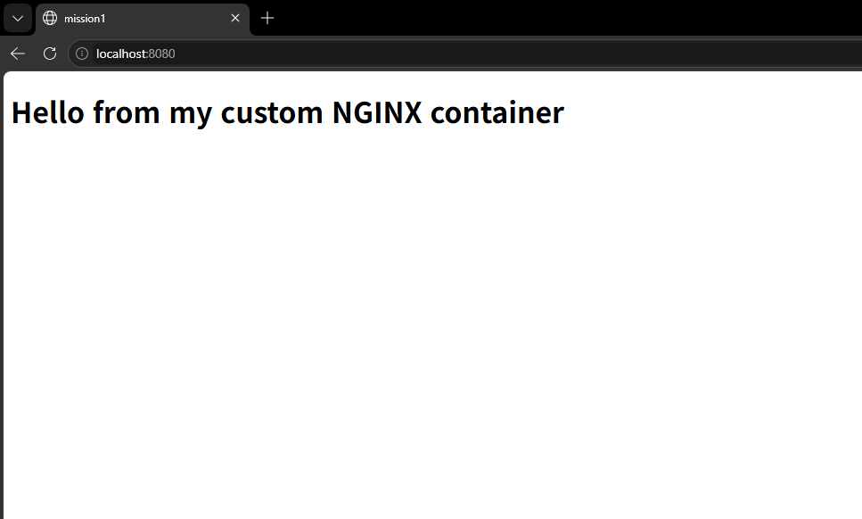
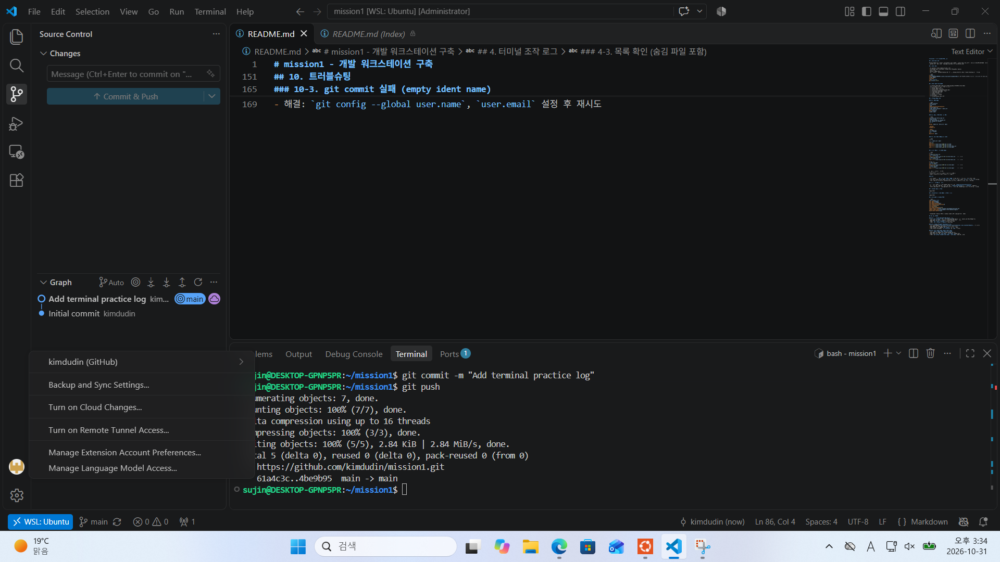

# mission1 - 개발 워크스테이션 구축

## 1. 프로젝트 개요

터미널(리눅스 CLI), Docker, Git/GitHub를 직접 세팅하고 사용해 보며, 누구나 같은 방식으로 실행·배포·디버깅할 수 있는 개발 환경을 구성한다. 모든 수행 과정은 명령어와 출력 결과로 이 문서에 기록한다.

## 1-1. 저장소 구조

```text
.
├── README.md                  # 기술 문서 (전체 수행 기록)
├── app                        # Dockerfile 기반 웹 서버
│   ├── Dockerfile             # nginx:alpine 기반 커스텀 이미지
│   └── index.html             # 교체한 정적 콘텐츠
├── docs
│   └── images                 # README에 첨부한 증거 스크린샷
│       ├── github-vscode-login.png
│       └── port-mapping.png
└── practice                   # 터미널/권한 실습 파일
    ├── hello.txt
    └── mydir                  # 권한 실습용 (빈 디렉토리라 Git에는 올라가지 않음)
```

- 출력은 `tree -a -I '.git'` 결과이며, 주석은 설명을 위해 직접 추가했다.

## 2. 실행 환경

- OS: Windows + WSL2 (Ubuntu 26.04.1 LTS)
- 쉘/터미널: bash (/bin/bash), VSCode 통합 터미널(WSL: Ubuntu)
- Git: 2.53.0
- Docker: Docker: 29.9.2 (Docker Desktop 4.97.0, WSL2 백엔드)
- 참고: 안내문은 macOS의 OrbStack 기준이지만, Windows 환경이라 WSL2 + Docker Desktop으로 대체한다.

```bash
$ uname -a
Linux DESKTOP-GPNP5PR 6.18.54.1-microsoft-standard-WSL2 #1 SMP PREEMPT_DYNAMIC Tue Oct  6 19:13:07 UTC 2026 x86_64 GNU/Linux
$ echo $SHELL
/bin/bash
$ git --version
git version 2.53.0
```

## 3. 수행 항목 체크리스트

- [x] 터미널 기본 조작 (위치/목록/이동/생성/복사/이동/삭제/내용 확인)
- [x] 권한 실습 (파일 1개, 디렉토리 1개)
- [x] Docker 설치 및 점검
- [x] Docker 기본 운영 명령
- [x] hello-world / ubuntu 컨테이너 실행
- [x] Dockerfile 기반 커스텀 이미지
- [x] 포트 매핑 접속 확인
- [x] 바인드 마운트
- [x] Docker 볼륨 영속성
- [x] Git 설정
- [x] GitHub/VSCode 연동 증거

## 4. 터미널 조작 로그

### 4-1. 기본 조작

```bash
$ mkdir practice
$ cd practice
$ pwd
/home/sujin/mission1/practice
$ touch empty.txt
$ echo "hello terminal" > hello.txt
$ cat hello.txt
hello terminal
$ mkdir mydir
```

### 4-2. 복사, 이동/이름변경, 삭제

```bash
$ cp hello.txt hello_copy.txt
$ mkdir backup
$ mv hello_copy.txt renamed.txt
$ mv renamed.txt backup/
$ ls -R
.:
backup  empty.txt  hello.txt  mydir

./backup:
renamed.txt

./mydir:
$ rm empty.txt
$ rm -r backup
$ ls
hello.txt  mydir
```

### 4-3. 목록 확인 (숨김 파일 포함)

```bash
$ ls -a
.  ..  hello.txt  mydir
$ ls -la
total 16
drwxr-xr-x 3 sujin sujin 4096 Oct 31 14:29 .
drwxr-xr-x 4 sujin sujin 4096 Oct 31 14:20 ..
-rw------- 1 sujin sujin   15 Oct 31 14:21 hello.txt
drwx------ 2 sujin sujin 4096 Oct 31 14:23 mydir
```

## 5. 권한 실습 (변경 전/후 비교)

```bash
# 파일
$ chmod 644 hello.txt
$ ls -l hello.txt
-rw-r--r-- 1 sujin sujin 15 Oct 31 14:21 hello.txt     # 변경 전
$ chmod 600 hello.txt
$ ls -l hello.txt
-rw------- 1 sujin sujin 15 Oct 31 14:21 hello.txt     # 변경 후

# 디렉토리
$ chmod 755 mydir
$ ls -ld mydir
drwxr-xr-x 2 sujin sujin 4096 Oct 31 14:23 mydir       # 변경 전
$ chmod 700 mydir
$ ls -ld mydir
drwx------ 2 sujin sujin 4096 Oct 31 14:23 mydir       # 변경 후
```

| 대상 | 변경 전 | 변경 후 |
|---|---|---|
| hello.txt | -rw-r--r-- (644) | -rw------- (600) |
| mydir | drwxr-xr-x (755) | drwx------ (700) |

### 해석

- 권한 문자열은 `유형 + 소유자 + 그룹 + 기타` 순서다. 맨 앞 `-`는 파일, `d`는 디렉토리다.
- r=4, w=2, x=1을 더한다. 644는 `rw-`(6) `r--`(4) `r--`(4), 755는 `rwx`(7) `r-x`(5) `r-x`(5)이다.
- 디렉토리의 x는 "그 안으로 들어갈 수 있는 권한"이라, 700이면 소유자만 접근할 수 있다.

## 6. 절대 경로와 상대 경로

- 절대 경로: 루트(`/`)부터 시작하는 전체 경로. 예: `/home/sujin/mission1/practice`
- 상대 경로: 현재 위치 기준 경로. 예: 현재 `/home/sujin/mission1`일 때 `practice`, 상위로는 `..`
- 어디서 실행해도 같은 곳을 가리키는 것이 절대 경로, 현재 위치에 따라 달라지는 것이 상대 경로다.

## 7. Docker 설치 및 운영

- Docker: 29.9.2 (Docker Desktop 4.97.0, WSL2 백엔드)

### 7-1. 버전 및 데몬 점검
```bash
$ docker --version
Docker version 29.9.2, build a82e528
$ docker info
(Client/Server 출력 중 Server 부분 발췌)
Server:
 Containers: 0
 Images: 0
 Server Version: 29.9.2
 Operating System: Docker Desktop
 Kernel Version: 6.18.54.1-microsoft-standard-WSL2
```

### 7-2. hello-world 실행

```bash
$ docker run hello-world
Unable to find image 'hello-world:latest' locally
latest: Pulling from library/hello-world
4f55086f7dd0: Pull complete 
d5e71e642bf5: Download complete 
Digest: sha256:c567b231f65614688711a75f31518a064258a51d442117a3e771a3a8fdba78ef
Status: Downloaded newer image for hello-world:latest

Hello from Docker!
This message shows that your installation appears to be working correctly.

To generate this message, Docker took the following steps:
 1. The Docker client contacted the Docker daemon.
 2. The Docker daemon pulled the "hello-world" image from the Docker Hub.
    (amd64)
 3. The Docker daemon created a new container from that image which runs the
    executable that produces the output you are currently reading.
 4. The Docker daemon streamed that output to the Docker client, which sent it
    to your terminal.

To try something more ambitious, you can run an Ubuntu container with:
 $ docker run -it ubuntu bash

Share images, automate workflows, and more with a free Docker ID:
 https://hub.docker.com/

For more examples and ideas, visit:
 https://docs.docker.com/get-started/
```

- 로컬에 `hello-world` 이미지가 없어서 Docker Hub에서 내려받은 뒤(`Pulling`, `Downloaded newer image`) 컨테이너를 실행했다.
- `Hello from Docker!`가 출력되어 클라이언트, 데몬, 이미지 다운로드, 컨테이너 실행 흐름이 정상 동작함을 확인했다.
```
### 7-3. 이미지/컨테이너 조회

```
$ docker images
IMAGE                ID             DISK USAGE   CONTENT SIZE   EXTRA
hello-world:latest   c567b231f656       25.9kB         9.49kB    U

$ docker ps
CONTAINER ID   IMAGE     COMMAND   CREATED   STATUS    PORTS     NAMES

$ docker ps -a
CONTAINER ID   IMAGE         COMMAND    CREATED          STATUS                      PORTS     NAMES
8e78e2fe53bc   hello-world   "/hello"   33 minutes ago   Exited (0) 33 minutes ago             flamboyant_vaughan

$ docker logs flamboyant_vaughan
Hello from Docker!
This message shows that your installation appears to be working correctly.

To generate this message, Docker took the following steps:
 1. The Docker client contacted the Docker daemon.
 2. The Docker daemon pulled the "hello-world" image from the Docker Hub.
    (amd64)
 3. The Docker daemon created a new container from that image which runs the
    executable that produces the output you are currently reading.
 4. The Docker daemon streamed that output to the Docker client, which sent it
    to your terminal.

To try something more ambitious, you can run an Ubuntu container with:
 $ docker run -it ubuntu bash

Share images, automate workflows, and more with a free Docker ID:
 https://hub.docker.com/

For more examples and ideas, visit:
 https://docs.docker.com/get-started/
```

- `docker images`: 내려받은 `hello-world` 이미지가 목록에 있다.
- `docker ps`: 실행 중인 컨테이너가 없어 비어 있다. hello-world는 메시지를 출력하고 바로 종료되기 때문이다.
- `docker ps -a`: 종료된 컨테이너까지 보인다. `Exited (0)`은 정상 종료를 뜻한다.
- `docker logs`: 컨테이너가 출력한 내용을 종료된 뒤에도 다시 볼 수 있다.

### 7-4. ubuntu 컨테이너 실행

```
$ docker run -it ubuntu bash
Unable to find image 'ubuntu:latest' locally
latest: Pulling from library/ubuntu
f3f25b84a7d7: Pull complete
edafa32f5d9e: Pull complete
21594acc2d8b: Download complete
Digest: sha256:6a06111c3b0a8600feadb270aec771dc239bf407b25625f93f44ab00e11f4d3c
Status: Downloaded newer image for ubuntu:latest
root@739237b54df7:/# ls
bin  boot  dev  etc  home  lib  lib64  media  mnt  opt  proc  root  run  sbin  srv  sys  tmp  usr  var
root@739237b54df7:/# echo hello from container
hello from container
root@739237b54df7:/# cat /etc/os-release
PRETTY_NAME="Ubuntu 26.04.1 LTS"
NAME="Ubuntu"
VERSION_ID="26.04"
VERSION="26.04.1 LTS (Resolute Raccoon)"
VERSION_CODENAME=resolute
ID=ubuntu
ID_LIKE=debian
HOME_URL="https://www.ubuntu.com/"
SUPPORT_URL="https://help.ubuntu.com/"
BUG_REPORT_URL="https://bugs.launchpad.net/ubuntu/"
PRIVACY_POLICY_URL="https://www.ubuntu.com/legal/terms-and-policies/privacy-policy"
UBUNTU_CODENAME=resolute
LOGO=ubuntu-logo
root@739237b54df7:/# hostname
739237b54df7
root@739237b54df7:/# exit
exit

$ docker ps -a
CONTAINER ID   IMAGE         COMMAND    CREATED          STATUS                      PORTS     NAMES
739237b54df7   ubuntu        "bash"     2 minutes ago    Exited (0) 13 seconds ago             wizardly_haslett
8e78e2fe53bc   hello-world   "/hello"   36 minutes ago   Exited (0) 36 minutes ago             flamboyant_vaughan
```

- 로컬에 `ubuntu` 이미지가 없어 Docker Hub에서 내려받은 뒤 컨테이너를 실행했다.
- 프롬프트가 `root@739237b54df7:/#`로 바뀌어 컨테이너 안에 들어온 것을 알 수 있고, `ls`와 `echo`가 정상 동작했다.
- `hostname`이 컨테이너 ID(`739237b54df7`)로 나온다. 호스트 이름(`DESKTOP-GPNP5PR`)과 다르므로 호스트와 격리된 별도 환경이다.
- `exit`로 나오자 메인 프로세스인 `bash`가 끝나 컨테이너도 `Exited (0)`이 되었다.

### 7-5. attach vs exec, docker stats

```
$ docker run -dit --name test-ubuntu ubuntu bash
7374fd47f8089e40dbc63930d379e26b5c50663bddc56b710f4fe20bc80512f1

$ docker exec -it test-ubuntu bash
root@7374fd47f808:/# exit
exit

$ docker ps
CONTAINER ID   IMAGE     COMMAND   CREATED          STATUS          PORTS     NAMES
7374fd47f808   ubuntu    "bash"    27 seconds ago   Up 26 seconds             test-ubuntu

$ docker stats --no-stream
CONTAINER ID   NAME          CPU %     MEM USAGE / LIMIT     MEM %     NET I/O         BLOCK I/O        PIDS
7374fd47f808   test-ubuntu   0.00%     10.98MiB / 7.617GiB   0.14%     1.17kB / 126B   20.6MB / 4.1kB   1

$ docker attach test-ubuntu
root@7374fd47f808:/# exit
exit

$ docker ps -a
CONTAINER ID   IMAGE         COMMAND    CREATED              STATUS                      PORTS     NAMES
7374fd47f808   ubuntu        "bash"     About a minute ago   Exited (0) 5 seconds ago              test-ubuntu
739237b54df7   ubuntu        "bash"     4 minutes ago        Exited (0) 2 minutes ago              wizardly_haslett
8e78e2fe53bc   hello-world   "/hello"   39 minutes ago       Exited (0) 39 minutes ago             flamboyant_vaughan
```

#### 관찰 결과
- `docker exec` 후 `exit`: 새로 띄운 셸만 종료되고 컨테이너는 계속 실행 중이다. (`docker ps`에서 `Up 26 seconds`)
- `docker attach` 후 `exit`: 컨테이너의 메인 프로세스(`bash`)가 종료되어 컨테이너도 `Exited (0)`이 된다. (`docker ps -a`에서 확인)
- 정리: `exec`은 실행 중인 컨테이너에 **새 프로세스를 추가**하는 것이고, `attach`는 **메인 프로세스에 직접 연결**하는 것이다. 컨테이너의 수명은 메인 프로세스에 달려 있다.
- `docker stats`: 실행 중인 `test-ubuntu`의 CPU 0.00%, 메모리 10.98MiB 사용을 확인했다. 컨테이너가 종료되면 `docker stats`에는 나타나지 않는다.

## 8. Dockerfile / 포트 매핑 / 마운트 / 볼륨

### 8-1. 커스텀 이미지 (A안: NGINX 베이스)

- 베이스 이미지: `nginx:alpine`
- 커스텀 포인트: 기본 `index.html`을 내가 만든 `app/index.html`로 교체 (정적 콘텐츠 교체)
- 목적: 공식 NGINX 이미지를 그대로 쓰되, 내 콘텐츠가 담긴 이미지를 만들어 어디서 실행해도 같은 결과가 나오게 한다.

```dockerfile
FROM nginx:alpine
COPY index.html /usr/share/nginx/html/index.html
```

### 8-2. 빌드/실행 및 포트 매핑 확인

```
$ docker build -t mission1-web .
[+] Building 1.1s (7/7) FINISHED                                    docker:default
 => [internal] load build definition from Dockerfile
 => => transferring dockerfile: 104B
 => [internal] load metadata for docker.io/library/nginx:alpine
 => [internal] load .dockerignore
 => => transferring context: 2B
 => [internal] load build context
 => => transferring context: 198B
 => [1/2] FROM docker.io/library/nginx:alpine@sha256:785835ea65db4bba6f021acc0f3be91b0fef76a53fe41f8588c6698d2aed0606
 => => resolve docker.io/library/nginx:alpine@sha256:785835ea65db4bba6f021acc0f3be91b0fef76a53fe41f8588c6698d2aed0606
 => CACHED [2/2] COPY index.html /usr/share/nginx/html/index.html
 => exporting to image
 => => exporting layers
 => => exporting manifest sha256:340a3c8a1e760a173965b4cdbd262e89d8ea197ea4f1e932b1d59b74d9a04e59
 => => exporting config sha256:f554c1d4a18e325abd70886269185215a974a158e43a445b5581eb369af1a58e
 => => exporting attestation manifest sha256:ed6cff06d30c9599eaa9c915a49e8b6f74522c0dbd6387835d29b8b23ede1d17
 => => exporting manifest list sha256:bee4b6f4203325598b14fd0b9ee729fd1f410761cad4026a69a3441dfec94bc3
 => => naming to docker.io/library/mission1-web:latest
 => => unpacking to docker.io/library/mission1-web:latest

$ docker run -d --name web -p 8080:80 mission1-web
eeeaf06452fe200bea4221bad9a8427d60f301292addd5203b73f597a614e725

$ docker ps
CONTAINER ID   IMAGE          COMMAND                  CREATED         STATUS         PORTS                                     NAMES
eeeaf06452fe   mission1-web   "/docker-entrypoint.…"   7 seconds ago   Up 7 seconds   0.0.0.0:8080->80/tcp, [::]:8080->80/tcp   web

$ curl http://localhost:8080
<!DOCTYPE html>
<html lang="ko">
<head><meta charset="UTF-8"><title>mission1</title></head>
<body><h1>Hello from my custom NGINX container</h1></body>
</html>
```

- `docker build`는 `app/Dockerfile`을 기준으로 `nginx:alpine` 위에 `index.html`을 복사한 이미지 `mission1-web`을 만든다. (`COPY` 단계가 `CACHED`인 것은 파일 내용이 이전 빌드와 같아 레이어를 재사용했기 때문이다.)
- `-p 8080:80`은 호스트 8080 포트를 컨테이너 80 포트에 연결한다. 컨테이너는 격리된 네트워크를 쓰므로 포트를 연결해야 호스트 브라우저에서 접속할 수 있다.
- `docker ps`의 `PORTS` 열 `0.0.0.0:8080->80/tcp`가 포트 매핑이 적용된 증거이고, `curl` 응답이 컨테이너의 NGINX가 내 `index.html`을 서빙한다는 증거이다.

### 8-3. 포트 매핑 증거



- 브라우저 주소창의 `localhost:8080`으로 접속해 컨테이너의 NGINX 페이지가 표시되는 것을 확인했다.

### 8-4. 바인드 마운트 (호스트 변경 반영)

**목적:** 호스트의 `app` 폴더를 컨테이너의 NGINX 웹 루트에 연결해, 이미지를 다시 빌드하지 않고도 호스트에서 고친 내용이 컨테이너에 바로 반영되는지 확인한다.

#### 실행
```
$ cd ~/mission1/app
$ docker rm -f web
web
$ docker run -d --name web-bind -p 8080:80 -v "$(pwd)":/usr/share/nginx/html mission1-web
b5a730d937364fcfd24b3e02971039aa78d809e76e602ac58b7e4303c31cc964
```

- `-v "$(pwd)":/usr/share/nginx/html`: 호스트의 현재 폴더(`app`)를 컨테이너의 `/usr/share/nginx/html`에 연결한다.

#### 변경 전
```
$ curl http://localhost:8080
<!DOCTYPE html>
<html lang="ko">
<head><meta charset="UTF-8"><title>mission1</title></head>
<body><h1>Hello from my custom NGINX container</h1></body>
</html>
```

#### 호스트에서 파일 수정 (컨테이너에서는 아무 작업도 하지 않음)
```
$ sed -i 's/Hello from my custom NGINX container/Hello! Changed on the host (bind mount)/' index.html
$ cat index.html
<!DOCTYPE html>
<html lang="ko">
<head><meta charset="UTF-8"><title>mission1</title></head>
<body><h1>Hello! Changed on the host (bind mount)</h1></body>
</html>
```

#### 변경 후 (재시작/재빌드 없음)
```
$ curl http://localhost:8080
<!DOCTYPE html>
<html lang="ko">
<head><meta charset="UTF-8"><title>mission1</title></head>
<body><h1>Hello! Changed on the host (bind mount)</h1></body>
</html>
```

#### 마운트 정보 확인
```
$ docker inspect web-bind --format '{{json .Mounts}}'
[{"Type":"bind","Source":"/home/sujin/mission1/app","Destination":"/usr/share/nginx/html","Mode":"","RW":true,"Propagation":"rprivate"}]
```

#### 정리
- 바인드 마운트는 호스트의 경로를 그대로 컨테이너에 연결하므로, 호스트에서 수정한 내용이 즉시 반영된다.
- 8-2처럼 `COPY`로 만든 이미지는 빌드 시점의 파일이 이미지에 고정된다. 반면 바인드 마운트는 호스트 파일을 실시간으로 보기 때문에 개발 중 코드나 콘텐츠를 자주 고칠 때 유용하다.
- 호스트 경로에 의존하므로 다른 환경에서는 같은 경로가 없을 수 있어 재현성은 떨어진다. 이 점이 Docker 볼륨(8-5)과의 차이이다.

### 8-5. Docker 볼륨 영속성

**목적:** 컨테이너를 삭제해도 볼륨의 데이터가 남는지 확인한다.

#### 볼륨 생성 및 확인
```
$ docker volume create mydata
mydata
$ docker volume ls
DRIVER    VOLUME NAME
local     mydata
```

#### 컨테이너에 볼륨 연결 후 데이터 쓰기
```
$ docker run --name vol-test -v mydata:/data ubuntu bash -c "echo 'persistent data' > /data/test.txt && cat /data/test.txt"
persistent data
```

#### 컨테이너 삭제 전/후
```
$ docker ps -a        # 삭제 전: vol-test 존재
CONTAINER ID   IMAGE          COMMAND                  CREATED         STATUS                     PORTS                                     NAMES
50ce25889e11   ubuntu         "cat /data/test.txt"     6 seconds ago   Exited (0) 5 seconds ago                                             vol-test
eeeaf06452fe   mission1-web   "/docker-entrypoint.…"   8 minutes ago   Up 8 minutes               0.0.0.0:8080->80/tcp, [::]:8080->80/tcp   web
(이하 test-ubuntu, wizardly_haslett, flamboyant_vaughan 행 생략)

$ docker rm vol-test
vol-test

$ docker ps -a        # 삭제 후: vol-test 없음
CONTAINER ID   IMAGE          COMMAND                  CREATED         STATUS                   PORTS                                     NAMES
eeeaf06452fe   mission1-web   "/docker-entrypoint.…"   9 minutes ago   Up 9 minutes             0.0.0.0:8080->80/tcp, [::]:8080->80/tcp   web
(이하 test-ubuntu, wizardly_haslett, flamboyant_vaughan 행 생략)
```

#### 컨테이너 삭제 후 새 컨테이너로 데이터 확인
```
$ docker run --rm -v mydata:/data ubuntu cat /data/test.txt
persistent data
```

#### 볼륨 상세
```
$ docker volume inspect mydata
[
    {
        "CreatedAt": "2026-10-31T09:04:22Z",
        "Driver": "local",
        "Labels": null,
        "Mountpoint": "/var/lib/docker/volumes/mydata/_data",
        "Name": "mydata",
        "Options": null,
        "Scope": "local"
    }
]
```

#### 정리
- 볼륨은 Docker가 관리하는 저장 공간으로, 컨테이너의 수명과 분리되어 있다. 컨테이너를 삭제해도 데이터가 남는다.
- 바인드 마운트는 호스트 경로를 직접 연결하고, 볼륨은 Docker가 위치를 관리한다. DB 데이터처럼 영속성이 필요한 경우에 적합하다.
- 컨테이너는 일회용으로 만들고, 유지해야 할 데이터는 볼륨에 두는 설계가 재현 가능한 환경의 기반이다.


## 9. Git 설정 및 GitHub 연동

```bash
$ git config --list
user.name=kimdudin
user.email=(마스킹)
init.defaultbranch=main
core.repositoryformatversion=0
core.filemode=true
core.bare=false
core.logallrefupdates=true
remote.origin.url=https://github.com/kimdudin/mission1.git
remote.origin.fetch=+refs/heads/*:refs/remotes/origin/*
branch.main.remote=origin
```



## 개념 정리

### 이미지와 컨테이너
- 이미지는 실행에 필요한 파일과 설정을 담은 **읽기 전용 템플릿**이다. (예: `ubuntu`, `mission1-web`)
- 컨테이너는 이미지를 바탕으로 만든 **실행 중인(또는 종료된) 인스턴스**이다.
- 하나의 이미지로 컨테이너를 여러 개 만들 수 있다. 컨테이너를 지워도 이미지는 남는다.
- 실습에서 확인: 같은 `ubuntu` 이미지로 `wizardly_haslett`, `test-ubuntu` 두 컨테이너를 만들었고, 각각 다른 ID와 hostname을 가졌다.
- 컨테이너는 호스트와 격리된 환경이라 "내 컴퓨터에서만 돌아가는" 문제를 줄인다.

### 포트 매핑이 필요한 이유
- 컨테이너는 자체 네트워크를 쓰므로, 컨테이너 안의 80 포트는 호스트에서 바로 접근할 수 없다.
- `-p 8080:80`으로 호스트 8080 포트와 컨테이너 80 포트를 연결해야 호스트 브라우저에서 접속된다.
- 실습에서 확인: `docker ps`의 `0.0.0.0:8080->80/tcp`와 `curl http://localhost:8080` 응답.

### Docker 볼륨 (영속 데이터)
- 컨테이너의 파일시스템은 컨테이너를 삭제하면 함께 사라진다.
- 볼륨은 Docker가 관리하는 별도 저장 공간이라 컨테이너의 수명과 분리된다.
- 실습에서 확인: `vol-test` 컨테이너를 삭제한 뒤에도 새 컨테이너가 `mydata` 볼륨의 `persistent data`를 읽었다.

### Git과 GitHub의 차이
- Git은 내 컴퓨터에서 변경 이력을 관리하는 **로컬 버전 관리 도구**이다. (`add`, `commit` 등)
- GitHub는 Git 저장소를 인터넷에 올려 **백업, 공유, 협업**을 하게 해 주는 **원격 플랫폼**이다. (`push`, `pull`)
- 실습에서 확인: 로컬에서 `commit`만 한 상태는 GitHub에 없었고, `push`한 뒤 저장소 페이지에 반영되었다. 원격에 새 commit이 있어 push가 거부되었을 때는 `pull` 후 합쳐서 해결했다.


## 10. 트러블슈팅

### 10-1. 재부팅 후 Ubuntu가 자동 설치되지 않음
- 문제: `wsl --install` 후 재부팅했더니 Ubuntu가 설치되지 않고 ubuntu.com 웹사이트가 열림
- 원인 가설: WSL 기능만 활성화되고 배포판 설치는 이어지지 않음
- 확인: `wsl --list --verbose`로 배포판 목록 확인
- 해결: `wsl --install -d Ubuntu`로 직접 설치

### 10-2. VSCode 터미널이 PowerShell로 열림
- 문제: 프롬프트가 `PS Microsoft.PowerShell.Core\FileSystem::\\wsl.localhost\Ubuntu\...`로 표시됨
- 원인 가설: WSL 연결 없이 네트워크 경로로 폴더를 열었음
- 확인: VSCode 왼쪽 아래에 `WSL: Ubuntu` 표시 여부 확인
- 해결: Ubuntu 터미널에서 `cd ~/mission1` 후 `code .`로 실행

### 10-3. git commit 실패 (empty ident name)
- 문제: `fatal: empty ident name not allowed`
- 원인 가설: 새 컴퓨터라 Git 사용자 정보가 비어 있음
- 확인: 오류 메시지가 `user.name`, `user.email` 설정을 안내
- 해결: `git config --global user.name`, `user.email` 설정 후 재시도

### 10-4. 이미지를 다시 만들었는데 바뀐 문구가 그대로 나옴
- 문제: `index.html`을 원래 문구로 되돌렸다고 생각했는데 `curl`에 바인드 마운트 실습 때의 문구가 계속 나옴
- 원인 가설: 파일이 실제로 복원되지 않았고, 그 파일로 만든 컨테이너가 응답하고 있음
- 확인: `cat index.html`로 파일 내용, `docker ps`로 실행 중인 컨테이너 확인
- 해결: `sed`로 파일 복원 후 `docker rm -f web web-bind`, `docker build`, `docker run`을 다시 실행
- 배운 점: `COPY`로 만든 이미지는 빌드 시점의 파일이 고정되고, 바인드 마운트는 호스트 파일을 실시간으로 본다.

### 10-5. docker stats 옵션 오타
- 문제: `docker stats --no--stream` 실행 시 `unknown flag: --no--stream`
- 원인 가설: 옵션 이름의 하이픈을 잘못 입력함
- 확인: 오류 메시지의 `Usage` 안내와 `docker stats --help`
- 해결: `docker stats --no-stream`으로 수정해 정상 출력

### 10-6. 컨테이너 이름 충돌
- 문제: `docker run --name web-bind ...` 실행 시 `Conflict. The container name "/web-bind" is already in use`
- 원인 가설: 이전 실습에서 만든 같은 이름의 컨테이너가 남아 있음
- 확인: 오류 메시지의 기존 컨테이너 ID, `docker ps -a`로 목록 확인
- 해결: `docker rm -f web-bind`로 삭제한 뒤 다시 실행

### 10-7. git push 거부 (fetch first)
- 문제: `! [rejected] main -> main (fetch first)`
- 원인 가설: 원격에 로컬에 없는 commit이 있음
- 확인: `git log --oneline`으로 원격에만 있는 commit 확인
- 해결: `git pull --no-rebase`로 합친 뒤 `git push`